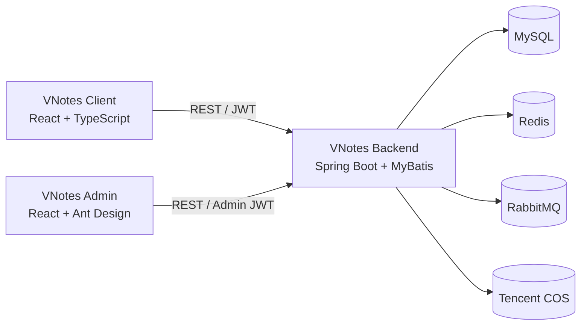

# VNotes

一款基于可视化节点画布的个人知识管理平台，包含用户客户端、后台管理系统和 Java 服务端。

用户可以通过树状节点组织目录、笔记、文章与图片，并使用引用节点建立跨笔记关联。系统同时提供标签检索、回收站、数据导入导出、公开分享和访问记录等功能，配套后台支持 RBAC 权限管理、客户端用户治理与操作审计。

> 本仓库是 VNotes 的项目总入口，用于集中展示项目说明、系统架构及各端源码。

## 在线体验

- 用户端：[https://vnotes.site](https://vnotes.site)

## 源码仓库

| 子项目 | 说明 | 技术栈 | 仓库 |
| --- | --- | --- | --- |
| VNotes Client | 用户客户端及可视化节点画布 | React、TypeScript、Vite、Tailwind CSS、SVG | [vnotes-client](https://github.com/vikim294/vnotes-client) |
| VNotes Admin | 运营后台与权限管理界面 | React、TypeScript、Vite、Ant Design | [vnotes-admin](https://github.com/vikim294/vnotes-admin) |
| VNotes Backend | REST API、认证授权、数据与消息服务 | Java 21、Spring Boot、MyBatis、MySQL | [vnotes-backend](https://github.com/vikim294/vnotes-backend) |

## 系统架构



## 核心功能

### 可视化知识组织

- 使用目录画布和详情画布组织树状知识结构
- 支持文本、图片、文章以及笔记/详情/文章引用节点
- 支持节点拖拽、父子关系调整、连线渲染和标记管理
- 支持画布平移、滚轮缩放、移动端双指缩放、视口记忆和节点居中
- 支持画布内节点搜索和跨笔记引用跳转

### 笔记管理

- 目录与笔记的新增、编辑、移动和批量保存
- 标签、关键词、节点类型和时间范围组合搜索
- 搜索历史、回收站恢复、定时清理和永久删除
- JSON 数据导入与导出
- 笔记公开分享、文章分享和访问记录

### 用户与认证

- 邮箱密码、邮箱验证码及 Google OAuth 登录
- JWT 无状态认证和客户端令牌版本控制
- Redis 登录失败限流及临时凭证管理
- 用户资料、头像上传和密码修改
- 站内通知

### 后台管理

- 管理员、角色和权限管理
- 用户—角色—权限三级 RBAC 模型
- 前端路由/操作级鉴权与服务端方法级鉴权
- 客户端用户状态及内容数据管理
- 敏感操作审计与 Excel 导出

## 核心技术实现

### 自研 SVG 节点画布

基于 SVG 和 Pointer Events 实现节点树渲染、拖拽交互、鼠标平移、滚轮缩放和移动端双指缩放。通过统一视口模型保存画布位置，并支持平滑的视口移动与节点聚焦动画。

### 批量编辑与并发控制

客户端使用 `new`、`edited`、`deleted` 状态收集节点差量，通过临时 UUID 表达新增节点间的父子关系；服务端在事务中完成批量新增、更新、删除及 UUID 到数据库 ID 的映射，并使用版本号乐观锁避免并发编辑覆盖。

### 树结构与数据一致性

使用 MySQL 递归 CTE 处理目录树和详情节点子树，实现层级查询、整棵子树移动、软删除和恢复。图片文件存储于腾讯云 COS，并通过格式、大小、像素校验及失败补偿降低数据库与对象存储状态不一致的风险。

### 认证与权限治理

基于 Spring Security 和 JWT 构建客户端、管理端两套认证体系。管理端采用 RBAC 权限模型及 `@PreAuthorize` 方法级鉴权；客户端结合用户状态和 `tokenVersion`，支持账号禁用后令牌即时失效。

### 异步事件处理

使用 Transactional Outbox 和 RabbitMQ 处理用户注册事件，通过 Publisher Confirm、消费重试、死信队列及“事件 ID + 消费者”唯一约束实现发布确认与幂等消费。

### 可观测性与部署

- 统一 API 响应和全局异常处理
- Request ID、Trace ID 与 MDC 日志上下文
- Flyway 数据库版本迁移
- Docker 与 Docker Compose 容器化
- GitHub Actions 自动构建并发布至 GHCR
- 支持 SHA 镜像部署、健康检查、Stable/Canary 灰度发布与流量切换

## 技术栈

| 分类 | 技术 |
| --- | --- |
| 用户端 | React 19、TypeScript、Vite、React Router、Tailwind CSS、SVG |
| 管理端 | React 19、TypeScript、Vite、React Router、Ant Design |
| 服务端 | Java 21、Spring Boot、Spring MVC、Spring Security、OAuth2 Resource Server、MyBatis |
| 数据与中间件 | MySQL 8、Redis、RabbitMQ、Flyway、腾讯云 COS |
| 工程与部署 | Docker、Docker Compose、GitHub Actions、GHCR |

## 本地运行

### 用户客户端

```bash
git clone git@github.com:vikim294/vnotes-client.git
cd vnotes-client
pnpm install
pnpm dev
```

### 后台管理系统

```bash
git clone git@github.com:vikim294/vnotes-admin.git
cd vnotes-admin
pnpm install
pnpm dev
```

### Java 服务端

```bash
git clone git@github.com:vikim294/vnotes-backend.git
cd vnotes-backend
cp .env.example .env
./mvnw clean package
docker compose up --build
```

启动前需要根据各仓库中的示例环境变量配置数据库、Redis、RabbitMQ、JWT、OAuth 及对象存储等服务。

## 项目结构

```text
VNotes
├── vnotes-client   用户客户端
├── vnotes-admin    后台管理系统
└── vnotes-backend  Java 服务端
```

## 项目说明

VNotes 是个人全栈项目，主要用于探索可视化知识管理、复杂树结构编辑、认证与权限治理、异步消息处理以及容器化部署等完整应用开发流程。
